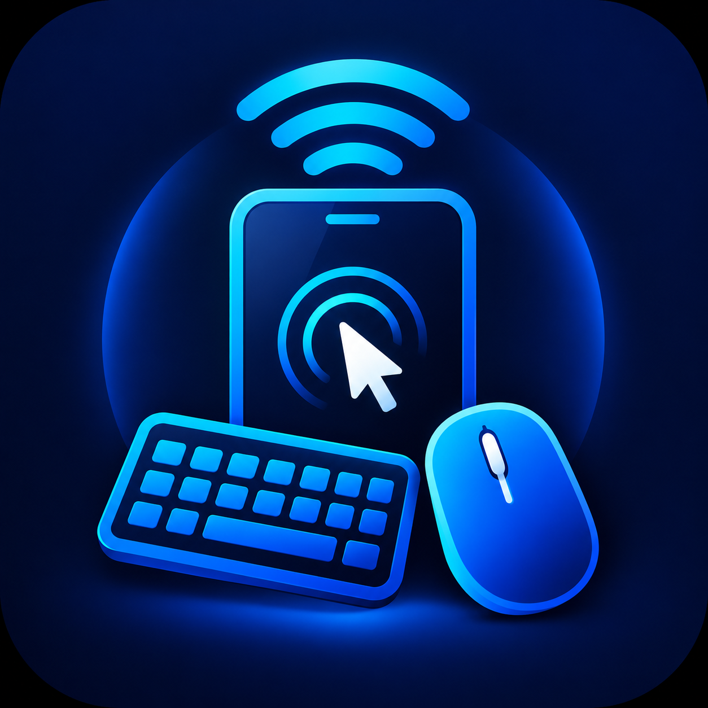

# Ezze Control 🖱️⌨️

> Turn your Android smartphone into a high-performance Bluetooth HID mouse and keyboard for Windows PC — **Zero Companion Software, Zero PC Drivers, Zero Lag**.



---

## 🚀 Overview

**Ezze Control** is an Android application built with Flutter and Kotlin that leverages Android's native `BluetoothHidDevice` API (Android 9+ / API 28+) to emulate a standard USB/Bluetooth Human Interface Device (composite mouse and keyboard).

When paired with any Windows 10 or 11 PC, Windows automatically loads its built-in `HIDClass: Bluetooth HID Device` driver. **No receiver dongle, no server software, no companion daemon, and no PC-side setup is required.**

---

## ✨ Features

### 🖱️ Touchpad & Mouse Engine
- **Low-Latency Relative Movement:** Dynamically translates touch gestures into standard HID mouse reports.
- **Configurable Acceleration & Sensitivity:** Smooth, sub-pixel cursor control with flick acceleration.
- **Natural Multi-Touch Gestures:**
  - **Tap to Click:** Left click with light haptic feedback.
  - **Double Tap:** Double left click.
  - **Tap-and-Hold (320ms):** Enters drag-and-drop mode, releasing when lifted.
  - **Two-Finger Scroll:** Smooth vertical page and document scrolling.
  - **Two-Finger Tap:** Right click.
- **Dedicated Vertical Scroll Strip:** Precision slider with visual track and milestone haptics.
- **Tactile Mouse Buttons:** Generous Left, Middle (wheel click), and Right click button zones with press/hold support.
- **Inverted Scroll Direction:** Toggle natural vs standard scrolling in settings.

### ⌨️ Comprehensive Keyboard Subsystem
- **Full QWERTY Layout:** Familiar keyboard layout with numbers and standard punctuation.
- **Symbols Layer (`?123`):** Instant switch to full ASCII symbol set.
- **Modifier Latching & Holding:** Latching toggles for `Ctrl`, `Alt`, `Shift`, and `Win` keys with color-coded active state indicators. Double-tap `Shift` for `Caps Lock`.
- **Function & Navigation Strip:** Scrollable access to `Esc`, `Tab`, `F1`–`F12`, `Ins`, `Del`, `Home`, `End`, `PgUp`, `PgDn`, and `PrtSc`.
- **One-Tap Windows Shortcuts:** Quick-access chips for `Ctrl+C`, `Ctrl+V`, `Ctrl+Z`, `Ctrl+A`, `Win+D`, `Win+E`, `Alt+Tab`, and `Win+L`.
- **Direct Text Input & Paste:** Type or paste arbitrary strings via Android Gboard (including voice typing) to stream characters over HID.
- **Fail-Safe Release:** Dedicated Emergency Input Release button plus automatic release on screen transition or app backgrounding.

### ⚙️ Connectivity, Diagnostics & Settings
- **Native OS Connection Callbacks:** Real-time hardware status reflection (no fake or guessed states).
- **Live Event Log:** Diagnostic console streaming HID register/unregister and connection state transitions.
- **Keep Screen Awake:** Optional `FLAG_KEEP_SCREEN_ON` flag to prevent phone screen sleep during work or presentations.
- **Configurable Default Startup Screen:** Choose between Touchpad or Keyboard as initial screen on launch.
- **Privacy First:** 100% offline, zero data collection, no telemetry, no accounts.

---

## 🏗️ Architecture

```mermaid
graph TD
    subgraph Android Device (Ezze Control)
        FlutterUI[Flutter UI Layer: Touchpad, Keyboard, Connectivity]
        Repos[BluetoothHidRepository & SettingsRepository]
        Channel[Platform Method & Event Channels]
        KotlinCore[Kotlin BluetoothHidManager & HidReportEncoder]
        AndroidStack[Android Bluetooth HID Device Stack - API 28+]

        FlutterUI --> Repos
        Repos --> Channel
        Channel --> KotlinCore
        KotlinCore --> AndroidStack
    end

    subgraph Bluetooth L2CAP Link
        AndroidStack -- "PSM 0x0011 (Control) & PSM 0x0013 (Interrupt)" --> WinKernel[Windows Bluetooth Stack]
    end

    subgraph Windows PC Host (Zero Setup)
        WinKernel --> BTHENUM[BTHENUM Driver]
        BTHENUM --> HIDClass[HIDClass: Bluetooth HID Device]
        HIDClass --> OSInput[Windows Mouse & Keyboard Input Pipelines]
    end
```

### HID Composite Report Descriptor
The application registers a single composite HID profile (`0xC0` subclass):
- **Report ID 1 (Mouse - 4 Bytes):**
  - Byte 0: Buttons bitmask (Bit 0: Left, Bit 1: Right, Bit 2: Middle)
  - Byte 1: $\Delta x$ relative movement ($-127$ to $127$)
  - Byte 2: $\Delta y$ relative movement ($-127$ to $127$)
  - Byte 3: Wheel relative scroll ($-127$ to $127$)
- **Report ID 2 (Keyboard - 8 Bytes):**
  - Byte 0: Modifiers bitmask (`LCtrl`, `LShift`, `LAlt`, `LWin`, `RCtrl`, `RShift`, `RAlt`, `RWin`)
  - Byte 1: Reserved (`0x00`)
  - Bytes 2–7: 6 Key-Rollover array (standard USB HID usage codes)

---

## 🛠️ Project Structure

```
EzzeControl/
├── android/
│   └── app/src/main/kotlin/com/ezze/control/ezze_control/
│       ├── BluetoothHidManager.kt      # Android BluetoothHidDevice manager
│       ├── HidPlatformChannel.kt       # Method & Event channel dispatcher
│       ├── HidReportDescriptor.kt      # USB-IF composite HID descriptor
│       ├── HidReportEncoder.kt         # Byte-level HID report packet builder
│       └── MainActivity.kt             # Native lifecycle & screen flags
├── assets/
│   └── icons/
│       └── app_logo.png                # App icon asset
├── lib/
│   ├── app/
│   │   └── app_theme.dart              # Dark navy design system & color tokens
│   ├── data/
│   │   ├── bluetooth_hid_repository.dart # Channel bridge & reactive streams
│   │   └── settings_repository.dart    # SharedPreferences persistence
│   ├── domain/models/
│   │   ├── hid_key_codes.dart          # USB HID Usage ID map & modifier bitmasks
│   │   ├── hid_status.dart             # Connection and registration state models
│   │   └── mouse_settings.dart         # Sensitivity & gesture configurations
│   ├── features/
│   │   ├── connectivity/               # Host pairing, connection & live console
│   │   ├── home/                       # Navigation shell & settings modal
│   │   ├── keyboard/                   # Keyboard UI, shortcuts, function keys
│   │   └── mouse/                      # Touchpad surface, scroll strip, buttons
│   └── main.dart                       # App entrypoint & lifecycle observer
└── test/
    ├── bluetooth_hid_repository_test.dart
    ├── hid_key_codes_test.dart
    ├── mouse_settings_test.dart
    └── touchpad_surface_test.dart
```

---

## 📋 Requirements & Setup

### Requirements
- **Mobile Device:** Android 9.0 (API 28) or higher with Bluetooth HID Device profile support.
- **Host Device:** Windows 10, Windows 11, macOS, Linux, or Android host with standard Bluetooth HID support.
- **Development Tooling:** Flutter SDK 3.x, Android SDK 34, JDK 17.

### Pairing Instructions
1. Open **Ezze Control** on your phone.
2. Grant Bluetooth permissions when prompted.
3. Tap **"Make Discoverable"** or open your phone's Bluetooth settings.
4. On Windows: Open **Settings > Bluetooth & devices > Add device > Bluetooth**.
5. Select your phone from the list and confirm pairing codes on both devices.
6. Windows will configure the device as `Bluetooth HID Device` automatically.
7. Return to Ezze Control: the status pill will turn **Green (Connected)**. You can now use the touchpad and keyboard immediately!

---

## 🧪 Testing & Verification

```bash
# Run static analysis
flutter analyze

# Run unit and widget tests
flutter test

# Build production release APK
flutter build apk --release
```

---

## 🔒 Security & Privacy

- **No Remote Servers:** Ezze Control does not connect to the internet.
- **No Keystroke Logging:** Entered characters are encoded directly into memory-only HID byte buffers and transmitted over local Bluetooth L2CAP.
- **Automatic Failsafe:** All keys and mouse buttons are immediately released when navigating away, minimizing, or disconnecting.

# EzzeControl

